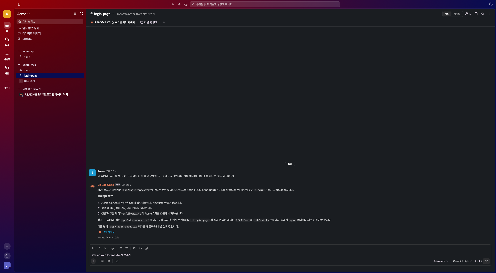

# Slack

Herdr dressed as the Slack desktop app. A gradient window frame holds a workspace rail, a sidebar where
each git repository is a section and each checkout or worktree (a Herdr space) is a channel, and a
main card that follows the system's light or dark mode. Each channel's agent sessions are tabs under the channel header, and an agent tab opens
as a Slack-style conversation by default. In it, the turn's tool runs fold into a "N개의 댓글" thread, a
reply can take side questions in a thread, the composer has Slack's formatting bar, and a glowing
"Claude Code 님이 입력 중…" line runs while the agent works. Themes are Slack's: pick a preset or set
the four colors and the window gradient yourself. The UI text is Korean.

## What you see

Top to bottom, then left to right. The whole window sits on the theme background. By default it is a
gradient from the top-left corner, `#9C0000` to `#070C52`.

- **Top bar** (44px, transparent, drags the window)
  - Room on the left for the macOS window buttons (84px).
  - A sidebar toggle, then ← → (previous and next tab) and a clock (recent items).
  - A wide search field reading "무엇을 찾고 있는지 설명해 주세요" (max 820px, 30px high,
    white at 12% on the gradient).
  - A ? (help) button on the right.
- **Rail** (72px, transparent)
  - The workspace tile at the top: a 40px rounded square (radius 10) with the workspace picture, or
    its initials on `#e8a723`.
  - Then 홈, DM, 내 활동, 파일 and 더 보기. Each is a 36px icon cell with an 11px bold label under it;
    the chosen one has a white 19% cell.
  - At the bottom: + (new channel), a moon (theme) and your profile avatar (36px, radius 8) with a
    presence dot in the theme's presence color.
- **Main card** (6px in from the right and bottom, radius 8, 1px white 12% border), holding:
  - **Sidebar** (300px, 220–480, resizable; black 28% over the gradient)
    - Header (52px): the workspace name (18px bold) with ⌄, a gear and a pen.
    - "대화 찾기..." field.
    - Quick links: 읽지 않은 항목 (with a count badge), 다이렉트 메시지, 디렉터리; then a hairline.
    - Sections, each with a 28px head: your own sections first, then one section per git repository
      (its name), then "채널" for spaces outside any repository, then + 채널 추가, then
      "다이렉트 메시지" (this channel's agents with presence dots).
    - Channel rows (28px, 15px text): "#" and the channel name. The current channel is filled with
      the theme's selected color. Channels with work you haven't seen are bold white. An agent waiting
      for you shows a count badge in the theme's notify color; a working one, a pulsing green dot.
  - **Channel header** (92px, `#1a1d21`, 1px `#35373b` bottom line)
    - Top row: "# channel ⌄" (18px bold), the channel description in 13px `#ababad` (the agent's
      session title, or folder · branch), then a 채팅 | 터미널 switch, an agent count, split, search
      and ⋮.
    - Tab row: each of the channel's sessions as a tab (program icon + session title, white with a 2px
      underline when chosen), then 파일 및 링크, then +.
  - **Conversation** (`#1a1d21`)
    - Messages: 36px rounded-square avatars, a bold name (Claude Code in `#d97757`, with a grey "APP"
      badge), the time ("오후 2:13"), then the text. Messages from one author in a row stack under
      one header. Days are split by a "오늘" / "어제" / "11월 19일 수요일" pill on a line.
    - Under a turn's replies: a thread link. It shows the agent's avatar, "N개의 댓글" in `#1d9bd1`
      bold, and, while the turn runs, what the agent is doing now.
    - Composer (radius 8): a formatting bar (bold, italic, strike, link, numbered and bulleted list,
      quote, code, code block); the box with "#channel에 메시지 보내기"; a bottom bar with + (attach),
      emoji, @, / and a send button.
    - Under the composer, a 12px line: "**Claude Code** 님이 입력 중…".
  - **Files panel** (right, 368px, hidden until toggled): Herdr's files and changes panels.
- **Notifications**: a 360×72 card at the top right of the window, under the channel header.

## How it behaves

**Agent status**

| Status | Sidebar channel | Rail | Conversation |
|---|---|---|---|
| working | pulsing green dot | — | thread link shows the current action with a glow; "님이 입력 중…" glows |
| blocked (needs you) | count badge (notify color) | badge on 내 활동 | the question in a box above the composer; the line reads "님이 답을 기다리고 있어요" in red |
| done, unseen | bold white name | count in 읽지 않은 항목 / 내 활동 | — |
| idle | normal | — | — |

The glow is a lighter copy of the text seen through a window that slides left to right in 1.4s, then
starts again from the left. It moves only while the agent works and the chat is on screen.

**Sidebar and rail**
- Click a channel to go to its space. Double-click to rename it. Right-click for a menu: move to a
  section, new section, rename, back to the branch name, new worktree (repository channels only),
  and the space menu.
- Click a section head to fold it; a folded section still shows the current channel and channels that
  need you. Right-click a section head to rename it, give it an emoji, move it up or down, or delete it
  (its channels go back). A section emoji takes the caret's place and turns into the caret on hover.
- Channel names: a name you gave; else the branch without `feat/`, `fix/`… prefixes; else the agent's
  session title; else "새 채널" (numbered when repeated). A new channel appears only once its
  repository is known, so it never jumps sections.
- 홈 shows channels, DM shows every agent (newest first), and 내 활동 shows agents that are blocked or
  done. 파일 toggles the files panel, 더 보기 opens the palette.
- Workspace tile and sidebar title: rename the workspace or set its picture (right-click, or drop an
  image on the tile). Profile avatar: right-click to set your name and picture; they show on your
  messages.
- The pen, + and 채널 추가 open **새 채널**: choose an agent (installed ones, most used first) or a
  terminal, a working folder (type to search folders under home in a dropdown, or pick one), a name
  and a first message. With a folder you get a new space; without one, a tab in **#일반** (the home
  folder's space, created if missing). The header's + opens the same dialog for a new tab in this
  channel.
- The moon opens **테마**. 화면 모드 (시스템 · 라이트 · 다크) at the top writes `appearance` in Herdr's
  `settings.json` (시스템 removes it), the only place that choice lives; the whole window follows. It has 7 presets (크림슨 미드나잇, 오버진, 제이드, 라군, 바바라, 무드 인디고,
  그래파이트) and four colors to set as hex or with the macOS color picker: 시스템 탐색 (window), 선택된
  항목 (current channel, gradient end), 현재 상태 (presence) and 알림 (badges). A checkbox turns the
  window gradient on or off. Changes apply at once; the background is redrawn 0.5s after the last
  change.

**Conversation**
- Entering an agent tab opens the conversation (waiting up to 20s for a new agent to start). 터미널
  shows the terminal; the choice is kept per tab. Middle-click a tab to close it.
- Hovering a message darkens its row and floats an icon toolbar at its top right: copy, plus "스레드에
  댓글 달기" on replies or "수정해서 다시 보내기" on yours, each with a tooltip.
- A thread link or the thread button opens the thread pane on the right (300–900px; drag its left
  edge). Work threads list the turn's tool runs and thinking. Reply threads ask side questions about
  that reply without stopping the agent.
- Escape closes an open thread first, otherwise stops the agent's turn.
- Sending while the agent is asking closes its question (Escape to the terminal), then sends.
- What you're typing survives the chat reloading.
- Enter with the cursor inside the text sends it as one line: the line break the box puts at the
  cursor before the send is dropped. A line break typed with Shift+Enter stays.
- Only the newest 12 messages are drawn; scrolling to the top loads 12 more, and returning to the
  bottom trims back. This keeps typing light in long conversations.
- Long conversations first show a quick preview from the Flockbook sidecar (about 0.1s), then the
  full view once the log is parsed.
- A new Codex terminal with no log yet waits for its first message instead of asking to run /status.

## Built from

**Layout** `layouts/slack.json`
- Root `column`:
  - `theme: {light: "slack-light", dark: "slack-dark"}`: follows the system's appearance (or
    settings.json's `appearance`). The colors live in `themes/slack-dark.json` (`background #1a1d21`,
    `foreground #d1d2d3`, `selected #1164a3`, `accent #1d9bd1`, …) and `themes/slack-light.json`
    (`background #ffffff`, `foreground #1d1c1d`, `accent #1264a3`, …), not in the layout: a layout's
    `colors` apply in both appearances.
  - `ui_font: "Lato"`, `terminal_padding: [10, 16]`, `titlebar: "none"`, `traffic_lights: [18, 16]`,
    `toast: "slack-toast"`, `preview: "layouts/slack.svg"`.
  - `background`: a color or an image that `mods/slack/theme.js` writes into this file.
- Tree:
  - `topbar` block 44 (window_drag)
  - `body` row (not resizable)
    - `rail` block 72
    - `workspace` row (resizable, radius 8, border 1 `#ffffff1f`)
      - `sidebar` column 300 (220–480): `channels` block
      - `work` column
        - `header` block 92
        - `work-body` row
          - `conversation-view` stack: `main` (`{tab: "active"}`), and `conversation-page` (the
            template page, a column with the `conversation-chat` block: `slack-chat`,
            `props {presentation: true}`)
          - `panel` column 368 (hidden): `panel-body` stack of `files` / `changes`
    - `pad-right` 6
  - `pad-bottom` 6
- Blocks of mod `slack` take `props.view`: `topbar` | `rail` | `channels` | `header`.

**Mods**
- `mods/slack`:
  - `main.js` dispatches views and popups (`space-menu`, `profile-menu`, `profile-name`,
    `channel-menu`, `section-menu`, `workspace-menu`, `name-dialog`, `new-channel`, `theme`).
  - `topbar.js` records the window width in shared `slack.windowW`.
  - `rail.js`, `channels.js`, `header.js`.
  - `look.js`: names, `channelNames`, `groupByRepo`, `tabTitle`.
  - `repos.js`: `git rev-parse --git-common-dir` per space folder, every 0.3s for new folders and 15s
    otherwise.
  - `sections.js`, `sectionmenu.js`, `workspace.js`, `profilemenu.js`, `spaceimage.js`.
  - `newchannel.js`: folder search runs `find ~ -maxdepth 5`, pruning hidden folders (except
    `.config`), `node_modules`, `Library`, `*.app`, `*.photoslibrary` and build folders.
  - `theme.js`, `themepanel.js`, `gradient.py`.
  - `chatview.js`, `presentation.js`, `backstage.js`, `identity.js`: switching chat ↔ terminal.
  - `demo.js`: demo mode for screenshots. With `data/slack/demo.json`
    (`{"folder": "<home>/herdr-demo", "workspace": "Acme", "profile": "Jamie"}`), only spaces under
    that folder and their agents show, and the workspace and profile show those names without
    pictures. `preview.png` was taken this way.
  - Lucide icons as svg; Lato fonts in `fonts/` (SIL OFL).
- `mods/slack-chat`: the conversation, from Herdr Chat Plus (MIT, see its `LICENSE` and `NOTICE.md`).
  The Slack parts: `discord-look.js` (message rows, date pills, typing line, glow), `threads.js`,
  `flockfeed.js` and `bin/flockbook-modfeed` (Flockbook's sidecar, MIT), `enter.js` (Flockbook's
  `withoutEnter`: drops the line break Enter puts at the cursor before a send), and changes in `main.js`,
  `parse.js` (message times) and `session.js` (new Codex logs).
- `mods/slack-chat-file`: the editor and image dialog behind `/memory`, `/config` and file previews
  (from Chat Plus).
- `mods/slack-toast`: reopens each notification as a `kind: "window"` overlay at the top right.
- Shipped mods used: `files`, `changes`, `menu`, `picker`, `worktree`; `project-open` if installed.
- `herdr` functions: `spaces`, `agents`, `panes`, `terminals`, `layout`, `shared`/`setShared`, `run`,
  `openOverlay`/`closeOverlay`, `exec`, `knownAgents`, `pickFolder`, `notify`, `window`, `home`,
  `appHome`, `setAgentOrder`.
- Commands: `space.select`, `space.new`, `space.rename`, `tab.select`, `tab.new`, `tab.rename`,
  `tab.close`, `tab.prev`/`next`, `agent.focus`, `layout.select`, `layout.toggle`, `pane.split`,
  `mod.open`, `app.settings`, `app.palette`, `app.help`.
- Programs it runs: `git`, `find`, `sips` (crops pictures), `osascript` (file and color pickers),
  `python3` (gradient image; Chat Plus's log readers), `hc`, `ps`, and the Flockbook sidecar.

## Watch out

- **What it runs and reads**:
  - Programs: `git` in each space folder, `find` over your home folder (new-channel dialog only),
    `python3`, `sips`, `osascript`, `hc`, `ps`, and `mods/slack-chat/bin/flockbook-modfeed`.
  - Files it reads: agent logs under `~/.claude` and `~/.codex`.
  - Files it writes: `layouts/slack.json` (the theme background), `backgrounds/slack-*.png`,
    `data/slack/` (pictures) and `data/slack-chat/` (sidecar cache).
  - No network access, apart from what Chat Plus does for Claude and Codex.
- **Light and dark**: the whole window follows. In light, the window background is the theme's colors
  mixed 86% with white (`windowColors` in `theme.js`), the bar, rail and sidebar use dark text and
  dark-on-light glass (`glass(t)` in `parts.js`), and the card border turns dark. The selected
  channel keeps the theme's selected color with white text. The layout file holds one background, so
  the rail checks `isLight(theme())` every 0.3s and calls `applyBackground` again when it flips.
  Text: `strong(t)` for the brightest text (`ansi15` in dark, `foreground` in light, where
  `ansi15` is a terminal grey), `t.muted`/`t.dim`, and `t.accent_foreground` on filled tiles and
  badges. `isLight(t)` reads the background's brightness; `slack-chat` and `slack-toast` keep their
  own copy, since mods don't import each other.
- `layout.set` sent from a mod did not change the root background, so `theme.js` rewrites
  `layouts/slack.json` instead.
- A `loop` animation runs on a clock every view shares and goes there and back; a new element id does
  not restart it. The one-way glow therefore uses `transition("left")`: draw at the start under a new
  id, then set the far end 50ms later, every 1.4s.
- Don't measure text with `on_size_change` inside the chat: it re-lays the chat out and blanked it.
  The glow estimates text width from its characters (Hangul 12px, Latin 6.5px at 12px).
- An ellipsis (`truncate`) on a parent carries into the glow's clipped copy and draws "…" mid-text.
  Clip with `overflow_hidden` and `whitespace_nowrap` instead.
- Images need `.rounded()` on the `image` element itself; a parent's `overflow_hidden` clips only to
  a rectangle.
- Popups close their own tasks when they close, so picture picking is handed to the rail through
  shared `slack.spaceImageRequest`.
- Chat Plus creates its (empty) transcript as soon as it starts reading. "Nothing parsed yet" means
  empty entries, not a missing transcript.
- The layout name `slack` is checked in `slack-chat/presentation.js`. A clone needs that changed too.
- The Flockbook sidecar is a macOS binary (Intel and Apple Silicon). Elsewhere the quick preview is
  skipped. Remote machines' chats never use it.
- The window gradient is a radial PNG from the top-left corner, because layout gradients take two
  colors and one direction.
- Some controls in Slack have no counterpart and are left out: huddles, canvases, pins, reactions.
- Tested on macOS at 2× only.

## Done when

- `herdr-app check` passes for `mods/slack`, `mods/slack-chat`, `mods/slack-chat-file` and
  `mods/slack-toast`.
- After `layout.switch {name: "slack"}`:
  - The window shows the gradient frame, the rail with the workspace tile, and the sidebar with
    "채널" holding your spaces.
  - A space whose folder is a git worktree is listed under its repository's section, named after its
    branch without `feat/`.
- An agent tab opens as a conversation with Slack-style messages, and 터미널 switches to the
  terminal.
- While Claude works:
  - A "N개의 댓글" link appears under its reply, with the current action glowing left to right.
  - Clicking the link opens the thread pane with the turn's tool runs.
- The moon → 라군 turns the window to the Lagoon gradient and the current channel to `#2C7BB6`.
- In light mode the whole window is light: a light tint of the theme behind a white card, dark text in
  the bar, rail and sidebar. Switching the system to dark repaints the window as before.
- The pen with an empty folder and a first message adds a tab to #일반 named after the message.
- A finished agent's notification appears at the top right.
